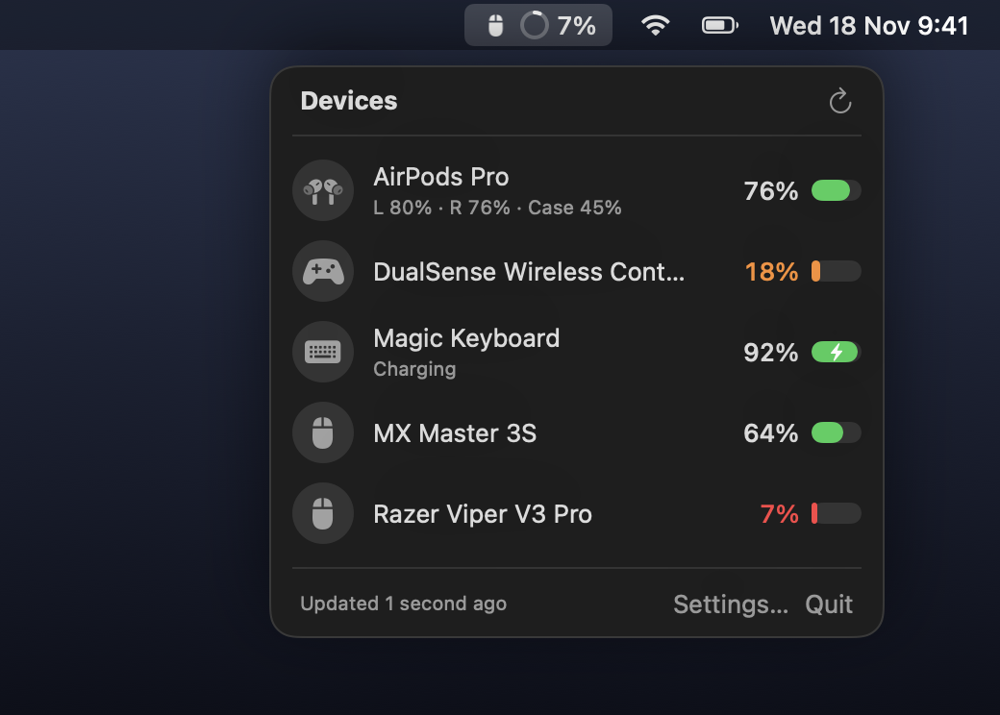

# Gadget Battery

**The battery of every wireless gadget in your Mac's menu bar — including the Logitech and Razer gaming receivers that Mac battery apps skip.**



Magic Battery and AirBuddy cover Apple and Bluetooth gear. Logitech G HUB, Logitech Options+ and Razer Synapse each show only their own brand. Gadget Battery puts all of them in one menu and a widget, and warns you before a device dies.

## Try it

You need a Mac with macOS 14 or later and Xcode 26.

```sh
git clone https://github.com/Danilqa/gadget-battery && cd gadget-battery
brew install xcodegen && xcodegen generate
xcodebuild -scheme GadgetBattery -derivedDataPath build build && open "build/Build/Products/Debug/Gadget Battery.app"
```

To see it without any gadgets connected, add sample devices: `open "build/Build/Products/Debug/Gadget Battery.app" --args -demo YES`.

## What it reads

| Gadgets | How |
| --- | --- |
| Magic Mouse, Magic Keyboard, Magic Trackpad | the battery level macOS keeps in the I/O Registry |
| AirPods, Beats and other Bluetooth headphones | the Bluetooth report behind `system_profiler` |
| PlayStation, Xbox and Switch controllers | Apple's GameController framework |
| Bluetooth LE gadgets with a battery service | Core Bluetooth |
| Logitech mice, keyboards and headsets on Unifying, Bolt or Lightspeed receivers, or on Bluetooth | Logitech's HID++ 2.0 protocol |
| About 30 Razer wireless mice on HyperSpeed receivers | Razer's USB battery command |

Logitech and Razer support follows [Solaar](https://github.com/pwr-Solaar/Solaar) and [openrazer](https://github.com/openrazer/openrazer), and hasn't been tried on every model yet. If your gadget is missing or shows a wrong level, [open an issue](https://github.com/Danilqa/gadget-battery/issues) with its name.

macOS asks for **Input Monitoring** before any app can read Logitech Bluetooth devices or Razer receivers, because they share a connection with the mouse. Gadget Battery asks only when you press **Allow Access…** in its menu, reads only the battery level, and never connects to the internet.

## Develop

- `App/`: the menu bar app
- `Widget/`: the widget
- `Packages/BatteryKit`: device protocols and readers. Test them with `cd Packages/BatteryKit && swift test`.

The README picture comes from `"build/Build/Products/Debug/Gadget Battery.app/Contents/MacOS/Gadget Battery" -demo YES -snapshotPanel "$PWD/docs/menu.png"`. The app icon comes from `swift scripts/render-icon.swift App/Assets.xcassets/AppIcon.appiconset`.

## License

[MIT](LICENSE) © 2026 Daniil Sitdikov. You can use, change and share the code, even commercially, as long as you keep the copyright notice and the license.
